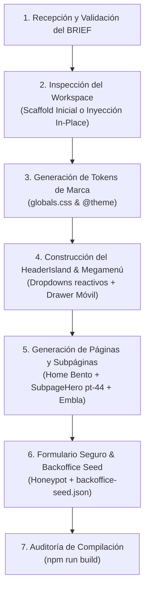

# 🎨 Site Craft Pro — Generador Quirúrgico de Sitios Web de Alta Fidelidad

Esta skill transforma un documento conciso de **Identidad, Catálogo de Productos y Megamenú** en un sitio web completo, moderno y de máximo rendimiento, implementado con la arquitectura estricta de **Astro 5 + Svelte 5 (Runes) + Tailwind CSS v4** y conectado al Backoffice Multitenant.

---

## 🚀 Principios Inquebrantables de Diseño (Craft Floor)

1. **Zero Div Soup:** Estructura exclusivamente semántica (`<header>`, `<nav>`, `<main>`, `<section>`, `<article>`, `<footer>`). Prohibido anidar divs innecesarios.
2. **Separación Quirúrgica:** Todo el contenido estático, SEO y layout base reside en `.astro` (Zero-JS baseline). La reactividad de cliente se aísla **únicamente** en `.svelte` con hidratación precisa (`client:load` para Header/Nav, `client:visible` para carruseles, calculadoras y formularios).
3. **Uso Exclusivo de Runas en Svelte 5:** Queda prohibida la sintaxis antigua (`let:` reactivo, `$:`, etc.). Todo estado se gestiona con `$state`, `$derived`, `$props` y `$effect`.
4. **Regla Anti-Solapamiento Mandatoria:** Para prevenir colisiones con el `HeaderIsland` fijo/flotante, toda subpágina (`src/pages/[ruta].astro`) debe usar `<SubpageHero />` con un padding superior estricto de `pt-44 sm:pt-44 lg:pt-48` sobre fondo oscuro (`bg-[#161618]`).
5. **Contrato Mandatorio de Integración Backoffice CMS (Zero-Code Dynamic Content):** Todo `BaseLayout.astro` debe inyectar el script universal `` y marcar quirúrgicamente los siguientes selectores en los componentes:
   - `[data-brand="logo"]` (con `data-brand-variant="dark|light"`), `[data-brand="name"]` y `<link rel="icon">`.
   - `[data-content="banner"]`, `[data-content="banner-text"]`, `[data-content="banner-cta"]`.
   - `[data-content="hero-badge"]`, `[data-content="hero-title"]`, `[data-content="hero-subtitle"]`.
   - `[data-content="hero-cta-primary"]`, `[data-content="hero-cta-secondary"]`.
   - `[data-content="footer-about"]`, `[data-content="footer-address"]`, `[data-content="footer-phone"]`.
   - `[data-content="footer-ruc"]`, `[data-content="footer-copyright"]`.
6. **Línea Base de Interactividad de Alta Fidelidad (Estándar Fluxora + Flexone):** La página principal debe implementar:
   - **Hero con Tilt 3D y Física de Resortes:** `perspective(1200px)`, `rotateX/Y` impulsado por `svelte/motion` (`Spring`), botón magnético con `ctaSpring`, doodles vectoriales tipo tiza y badges flotantes (`CDR SUNAT`, `Módulos Core`, `Ahorro`).
   - **Bento Grid con Spotlight Dinámico:** Foco de luz radial `radial-gradient` que sigue las coordenadas relativas del cursor en cada tarjeta (`onmousemove`).
   - **Micro-Simulaciones SVG Vivas:** Diagramas animados de flujo de datos (ej. Conciliación bancaria IA, validación de comprobante OSE/SUNAT en 120ms, tickets POS y tendencias OLAP).
   - **Marquee Infinito de Clientes:** Doble carril continuo con `@keyframes marquee` y logos reales con efecto satinado/hover.
   - **Simuladores con Spring:** Contadores numéricos que ruedan de forma fluida (`Spring`) al interactuar con sliders de cálculo.
7. **Sistema Tipográfico y Botones Estandarizados (UI/UX Theory & Anti-Overflow):**
   - **Escala Tipográfica:** H1 a 48-60px (desktop) / 30-36px (mobile) `font-black leading-[1.12]`, H2 a 32-36px (desktop) / 24px (mobile) `leading-tight`, párrafos body a 15-16px `leading-relaxed (1.60-1.65)` con contraste WCAG AA, y badges de categoría a `text-xs font-mono uppercase tracking-wider font-bold`.
   - **Botones Accesibles:** Botones primarios `.btn-primary` con altura $\ge 48\text{px}$ (`px-7 py-3.5 rounded-xl uppercase tracking-wider font-bold shadow-xl`), botones secundarios `.btn-secondary` (`px-6 py-3.5 backdrop-blur-md`) y pestañas `.btn-tab`.
   - **Zero Horizontal Scroll:** `overflow-x: clip; max-width: 100vw;` en `html, body`. Contenedores interactivos e islas Svelte con `w-full max-w-full overflow-hidden sm:overflow-visible`, y padding responsivo seguro (`p-4 sm:p-8 lg:p-10`). Ver [references/typography-buttons-standards.md](references/typography-buttons-standards.md).

---

## 🔄 Flujo de Ejecución (Paso a Paso)

### Paso 1: Recepción y Validación del BRIEF
1. Si el usuario proporcionó una ruta como argumento (ej. `/site-craft-pro cliente-brief.md`), léela directamente.
2. Si no se especificó argumento, busca si existe `BRIEF.md` o `SPEC.md` en la raíz del espacio de trabajo.
3. Si no existe ningún archivo, presenta la plantilla interactiva de [references/brief-template.md](references/brief-template.md) en el chat y solicita al usuario que complete las 3 secciones indispensables:
   - **Pilar 1:** Identidad de marca (nombre, eslogan, colores, logos).
   - **Pilar 2:** Catálogo de productos y servicios (ofertas, descripciones, beneficios, FAQs).
   - **Pilar 3:** Arquitectura web y megamenú (columnas del menú, índice de rutas).

### Paso 2: Inspección y Preparación del Entorno
- **Si el directorio está vacío:**
  - Inicializa el proyecto con Astro 5, Svelte 5, Tailwind CSS v4 y `embla-carousel-svelte`.
  - Configura `astro.config.mjs` con `@tailwindcss/vite` y `@astrojs/svelte`.
  - Agrega el Dockerfile y configuración Nginx ligera.
- **Si ya existe un proyecto Astro:**
  - Inspecciona las dependencias existentes y conserva la configuración base sin romper compatibilidad.

### Paso 3: Síntesis de Tokens de Diseño (`globals.css`)
- Extrae los colores primarios y secundarios del BRIEF e inyéctalos en `@theme` en `src/styles/globals.css`.
- Configura el modo oscuro base (`#161618` para headers y héroes, `#202124` para footers, `#ffffff` para secciones de contenido).

### Paso 4: Construcción del Megamenú (`HeaderIsland.svelte`)
- Implementa la arquitectura descrita en [references/megamenu-patterns.md](references/megamenu-patterns.md).
- Genera los dropdowns multinivel correspondientes al catálogo del cliente (2 a 4 columnas por categoría).
- Configura el drawer móvil con acordeones y botones de acción rápida.
- Asegura que los logos lleven los atributos `data-brand="logo" data-brand-variant="dark"`.

### Paso 5: Generación Modular de Páginas
- **Página de Inicio (`src/pages/index.astro`):**
  - **Hero:** Título potente, eslogan, doodles decorativos SVG, badges flotantes y CTA principal.
  - **Bento Grid de Soluciones:** Tarjetas de alto contraste con iconos y métricas de éxito.
  - **Carrusel Interactivo (`EmblaCarouselIsland.svelte`):** Carrusel con tabs de filtrado por categoría (siguiendo [references/interactive-islands.md](references/interactive-islands.md)).
  - **Calculadora / Cotizador:** Sliders interactivos en Svelte 5 para estimación instantánea.
  - **Sección FAQ:** Acordeones accesibles en Svelte 5 con cero CLS.
  - **Formulario de Contacto:** `ContactFormIsland.svelte` con honeypot anti-spam.
- **Subpáginas (`src/pages/[categoria]/[slug].astro`):**
  - Aplica estrictamente `<SubpageHero />` con padding `pt-44 sm:pt-44 lg:pt-48` siguiendo [references/subpage-layout-standards.md](references/subpage-layout-standards.md).
  - Incluye bloques bento, comparativas de características, llamadas a la acción y testimonios.

### Paso 6: Integración con el Backoffice y Semilla JSON
- Sigue las instrucciones de [references/backoffice-integration.md](references/backoffice-integration.md).
- Genera en la raíz del proyecto el archivo `backoffice-seed.json` con toda la configuración del cliente (teléfonos, WhatsApp, colores, logos y links sociales).

### Paso 7: Auditoría y Compilación
- Ejecuta `npm run build` para comprobar que las 32+ rutas compilen limpiamente en <5 segundos.
- **Auditoría de Tipografía y Cero Desborde:** Ejecuta un barrido con Playwright verificando que ningún elemento o página active scrollbar horizontal (`scrollWidth <= clientWidth`) en Desktop (1440px) y Mobile (375px), y que la escala tipográfica y botones respeten [references/typography-buttons-standards.md](references/typography-buttons-standards.md).
- Reporta al usuario la lista completa de páginas creadas, capturas de verificación y el comando para importar el seed en el Backoffice.

---

## 📚 Documentación de Referencia Incluida

- **Plantilla de Brief:** [references/brief-template.md](references/brief-template.md)
- **Patrones de Megamenú:** [references/megamenu-patterns.md](references/megamenu-patterns.md)
- **Estándares de Layout y Despeje:** [references/subpage-layout-standards.md](references/subpage-layout-standards.md)
- **Estándar Tipográfico y Botones:** [references/typography-buttons-standards.md](references/typography-buttons-standards.md)
- **Islas Interactivas (Carruseles, Calculadoras, Forms):** [references/interactive-islands.md](references/interactive-islands.md)
- **Integración con Backoffice:** [references/backoffice-integration.md](references/backoffice-integration.md)
